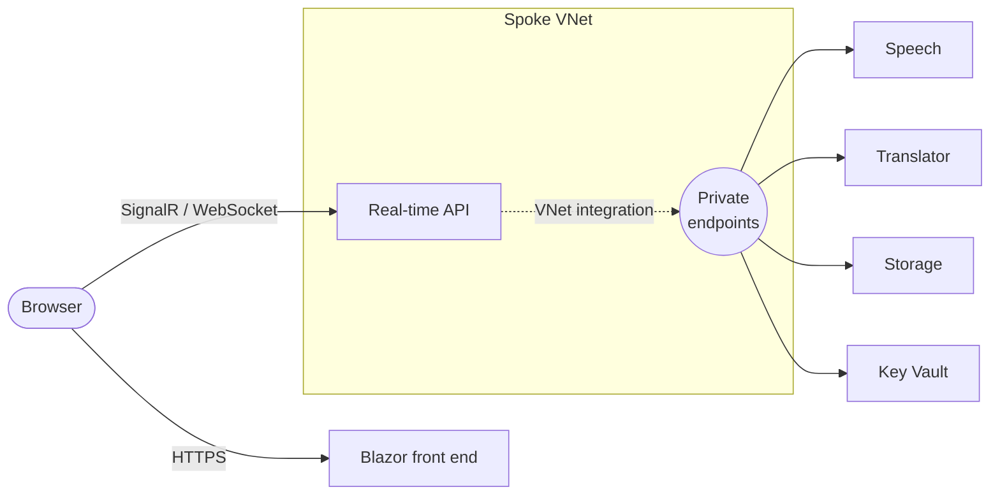

# terraform-azurerm-ai-stt

Terraform module for a **real-time speech-to-text and translation** workload on Azure, built to run **without secrets**: no keys, connection strings or passwords in code, pipelines or app settings.

- **Standalone:** [`examples/standalone`](examples/standalone) deploys a small spoke network and the workload.
- **Batch processing:** [terraform-azurerm-ai-stt-batch](https://github.com/goosain-platform-lab/terraform-azurerm-ai-stt-batch) adds a queue-driven pipeline (transcribe, translate, summarise) that plugs into this module's `shared_services` output.
- **In a landing zone:** [ai-landing-zone-lab](https://github.com/goosain-platform-lab/ai-landing-zone-lab) consumes both modules at pinned tags.

## What it deploys



| Component | Resource | Default SKU |
|---|---|---|
| Real-time translation API (.NET 8, SignalR) | Windows Web App | Plan B1 |
| Front end (Blazor WebAssembly) | Windows Web App | same plan |
| Speech to text | Speech service | S0 |
| Translation | Translator | S1 |
| Audio and results | Storage account (private, no shared keys) | Standard LRS |
| Secrets that must remain | Key Vault (RBAC, private) | Standard |
| Telemetry | Application Insights → your Log Analytics workspace | — |

Names follow `<type>-<workload>-<environment>-<region>`, for example `spch-stt-lab-zan` and `app-stt-api-lab-zan`.

## Secretless by design

| Common pattern | This module |
|---|---|
| Speech and Translator keys in app settings | Key auth disabled; the API's managed identity has **Cognitive Services Speech User** / **Cognitive Services User** |
| Storage connection string | Shared keys disabled; `Storage__BlobServiceUri` + managed identity |
| App Insights instrumentation key | Local auth disabled; telemetry sent with an Entra token |
| Deployment service principal secret in CI | HCP Terraform dynamic credentials (OIDC); no secret exists |
| Public endpoints on data services | Private endpoints; public access off |

Terraform never sees a secret value. If something has to be a secret (for example a third-party API key), an operator stores it in Key Vault and the app reads it through a **Key Vault reference**. See [step 4](#4-key-vault-secrets-only-if-you-need-one).

## Setup

### 1. One-time Azure setup

**Makes changes.** Run in Windows PowerShell on your machine after `az login`:

```powershell
.\scripts\bootstrap-azure.ps1 -SubscriptionId <subscription-id> `
  -HcpOrganization <your-hcp-org> -Workspaces ai-stt-lab
```

The script:
- creates an app registration with **federated credentials** for the workspace (plan and apply), and no client secret;
- grants it **Contributor** and **Role Based Access Control Administrator** on the subscription. The second role is for the module's role assignments; you can later add a condition limiting it to those roles;
- creates an **ai-lab-admins** Entra group with you in it;
- prints the values for step 2.

### 2. HCP Terraform workspace

1. Create workspace `ai-stt-lab` (VCS-driven, this repo).
2. **Terraform working directory:** `examples/standalone`.
3. **Environment variables** (from the script output):

   | Key | Value |
   |---|---|
   | `TFC_AZURE_PROVIDER_AUTH` | `true` |
   | `TFC_AZURE_RUN_CLIENT_ID` | app registration client ID |
   | `ARM_SUBSCRIPTION_ID` | subscription ID |
   | `ARM_TENANT_ID` | tenant ID |

4. **Terraform variables:** optional, see [`terraform.tfvars.example`](examples/standalone/terraform.tfvars.example).

None of these are secrets, and nothing goes in GitHub secrets.

### 3. Deploy

Queue a plan in HCP Terraform, review it, then apply.

For a local run instead: delete the `cloud {}` block in `versions.tf`, run `az login`, then `terraform init` and `terraform apply`.

### 4. Key Vault secrets (only if you need one)

1. Give yourself **Key Vault Secrets Officer** on the vault.
2. The vault is private. Work from a VNet-connected machine, or briefly allow your IP:
   ```powershell
   az keyvault update -n <kv-name> --public-network-access Enabled --default-action Deny
   az keyvault network-rule add -n <kv-name> --ip-address <your-ip>
   az keyvault secret set --vault-name <kv-name> -n external-api-key --value <value>
   ```
3. The next Terraform apply sets public access back to **Disabled**.
4. Map the secret to an app setting:
   ```hcl
   api_key_vault_references = { "ExternalApi__Key" = "external-api-key" }
   ```
   The API gets `@Microsoft.KeyVault(VaultName=...;SecretName=external-api-key)` and resolves it with its managed identity, which already has **Key Vault Secrets User**.

### 5. Deploy the app code

Both apps are public by default. Deploy them from GitHub Actions with `azure/login` (OIDC) and `azure/webapps-deploy`; basic publishing credentials are disabled.

## App code requirements

The apps authenticate with `DefaultAzureCredential` (or `ManagedIdentityCredential` using `AZURE_CLIENT_ID`):

| Service | How |
|---|---|
| Speech | Build the speech config from `Speech__Endpoint` and a `TokenCredential` (supported by current Speech SDK releases), not a key |
| Translator | Call `Translator__Endpoint` with an Entra bearer token |
| Storage | `new BlobServiceClient(new Uri(Storage__BlobServiceUri), credential)` |
| Front end | Keep keys out of `wwwroot/appsettings.json`: everything in a WebAssembly app is public |

## Cost

The B1 plan and four private endpoints run around the clock; Speech and Translator are pay-per-use. Run `terraform destroy` when you're done. Key Vault purge protection is off in the lab, so the same name can be redeployed straight away.

## Module reference

**Required inputs:** `location`, `resource_group_name`, `app_subnet_id`, `private_endpoint_subnet_id`, `private_dns_zone_ids` (keys `blob`, `vault`, `cognitive`), `log_analytics_workspace_id`. Everything else has a default; see [`variables.tf`](variables.tf).

**Outputs:** `identity`, `key_vault`, `endpoints`, `apps`, `shared_services` (consumed by the batch module), `application_insights_id`.

**Versioning:** releases are tagged (`v0.1.0`, ...), and consumers pin with `?ref=v0.1.0`.
